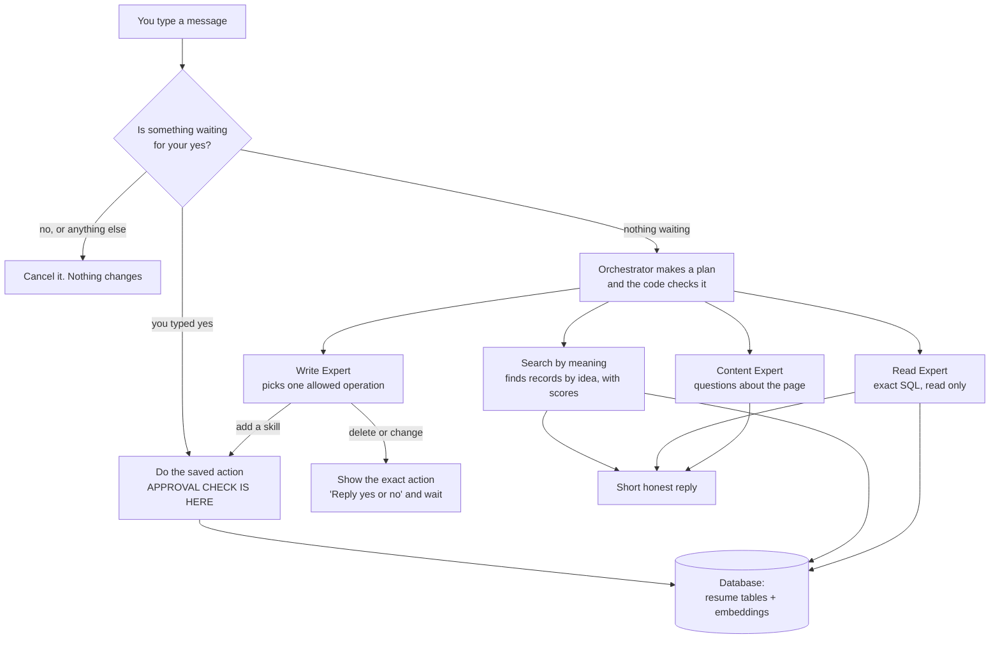

# Design and Testing Report — Homework 2

**Name:** Lama A. Almasri
**GitHub fork/branch URL:** https://github.com/shahdbatrawi/ai-agents/tree/lama-hw2
**Demo video link:** 
**Command that runs my tests:** `python tests/run_scenarios.py` 
## 0. Starting point

My HW1 app worked in the chat, but it did not pass the "Before You Start" checks:

- **Restart test: failed.** Startup called `createTables(purge=True)`, which dropped all tables and reloaded the CSV files. A skill added in the chat disappeared after a restart, and a deleted skill came back.
- **`eval()` / `exec()`: both used.** In `llm.py`, the Orchestrator's plan was run with `eval()`, and the Write Expert's generated Python code was run with `exec()`. Any model output could run as code.
- **Embedding test: done first.** Before building search, I called the OpenRouter embeddings endpoint with `openai/text-embedding-3-small` and checked that it returns a list of numbers in `data[0].embedding`.

What I fixed first: the startup, so data survives a restart (Phase 1). Then I added embeddings and search by meaning, the JSON plan, and two-step requests. Last, I replaced `exec()` with allowed operations and the approval check.

## 1. How my system works



**The approval check** sits in the "Do the saved action" box (`perform_action()` in `write_actions.py`). It is the only code that changes the data, so nothing can skip it.

**Each part, and what changed from HW1:**

- **Startup:** the resume CSVs are loaded only when the database is new. The expert prompts (`llm_roles.csv`) are reloaded at every start. *HW1 wiped everything at every start.*
- **Embeddings:** every record has one embedding (a list of numbers that stands for its meaning) in a new `embeddings` table. New or changed records get a new one, and deleted records lose theirs. *New in HW2.*
- **Orchestrator:** returns a JSON plan with a route (`exact`, `semantic`, `two_step`, `write`, `content`), a one-line reason and up to 3 steps. The code reads it with `json.loads` and rejects anything unknown. *HW1 ran the plan with `eval()`.*
- **Search by meaning:** a step done by code, not by a model. It compares the question's embedding with every record's embedding (cosine similarity) and returns the table, ID, text and score. *New in HW2.*
- **Two steps:** step 2 receives step 1's result. For "What did I do at MSU?", search finds "Michigan State University", and the Read Expert uses that exact name. *New in HW2.*
- **Write Expert:** picks one operation from a fixed list and fills in its values as JSON. Deleting or changing data waits for `yes`. *HW1 generated Python that ran with `exec()`.*
- **Trace:** every message prints a request ID, the route and reason, the steps, the search scores, the approval state and the outcome in the terminal. *New in HW2.*

## 2. Where to find things in my code

| What | File / function / table |
|---|---|
| Search by meaning (returns table, ID, text, score) | `flask_app/utils/semantic_search.py` → `semantic_search()`; embeddings made by `flask_app/utils/embeddings.py` → `get_embedding()`; stored in the `embeddings` table; kept up to date by `database.py` → `syncEmbeddings()` |
| Trace output | `flask_app/utils/llm.py` → `class Trace`, used in `handle_chat()` and `handle_pending()` |
| Test command | `tests/run_scenarios.py` (saves every trace to `tests/last_run_traces.txt`) |
| Settings (`.env.example`) | `homework 2/.env.example`: `OPENROUTER_API_KEY`, `CHAT_MODEL`, `EMBEDDING_MODEL`, `SEARCH_MIN_SCORE`, `SKILL_MIN_SCORE` |
| Approval check and allowed operations | `flask_app/utils/write_actions.py` → `OPERATIONS` (the list), `perform_action()` (the check), `classify_reply()` (yes / no / other); waiting actions in `llm.py` → `PENDING_ACTIONS` and `handle_pending()` |

## 3. Three decisions I made

| Decision | Options I considered | What I chose | Why, and the trade-off | What would make me choose differently |
|---|---|---|---|---|
| 1. How search by meaning fits into the agent | (a) Extend the Read Expert so it also searches. (b) A separate Semantic Search step. | (b) A "Semantic Search" step in the plan, run by my code without a model call. | **Gained:** the results and scores are exact and always shown in the trace, and in two-step requests the next step gets the real stored name. **Gave up:** the Orchestrator has one more option to choose correctly, so I had to add routing rules and examples to its prompt. | If many questions needed search and SQL filters together (for example "AI skills I used after 2020"), one extended Read Expert could do both in a single step. |
| 2. What text I embed and the cut-off scores | Embed names only, or names plus details. One cut-off for everything, or a different one for skills. | Institutions: name, department, city, state. Positions: "title at institution: responsibilities". Experiences: "name: description". Skills: name only. Two cut-offs: `SEARCH_MIN_SCORE=0.35` and `SKILL_MIN_SCORE=0.31`. | I measured the numbers instead of guessing. "MSU" gave Michigan State University 0.620, while the best unrelated result for "Harvard" was 0.298, so 0.35 separates them. Skills are short names, so they score lower. For "AI skills": NLP 0.320 and Python 0.305, so 0.31. **Gave up:** the skill margin is small (0.015), so a new wording can land on the wrong side. | More test questions with known answers. If they overlapped, I would embed each skill with its experience description, or keep only results close to the best score. |
| 3. How `yes` is matched to the action | Ask the model whether the reply means yes. Accept many phrases. Accept only a clear "yes". | Only "yes" or "y" approves (any capitals or punctuation). The waiting action is saved as a frozen `Action` with the exact skill IDs, one per browser tab. Any other reply cancels it. | **Gained:** nothing is approved by mistake, and `yes` runs the saved action without asking the model again, so the action can't change. `perform_action()` refuses a delete unless it gets the same saved action that was approved. **Gave up:** "yes please" cancels, and the user has to ask again. | If users kept getting cancelled by polite replies, I would accept a small fixed list like "yes please" and "confirm", still checked by code, not by the model. |

**My rule for unclear answers and changing the subject:** any reply that is not `yes` or `no` cancels the waiting action. A short reply (3 words or fewer, like "maybe" or "IDK") gets: "That wasn't a clear yes, so I cancelled it. Nothing was changed." A longer message is treated as a new request and answered normally. If the user then types `yes`, the app says "There is nothing waiting for your approval", so the old action can never be approved.

## 4. Testing

All scenarios run on the test data (`fixtures/` → `flask_app/database/test.db`), never on my own resume, using `python tests/run_scenarios.py`.

| Scenario / what I typed | What should happen | What actually happened | Pass / fail | Evidence (test output, screenshot, log) |
|---|---|---|---|---|
| S1 `Find my MSU experience` | Michigan State University among the top results, with scores in the trace | Route `semantic`. Michigan State University ranked first as a MATCH, with its score shown in the trace | Pass | test output; `tests/last_run_traces.txt` |
| S2 `What AI skills do I have?` | Machine Learning comes back; Public Speaking doesn't | **First run failed.** Machine Learning 0.491 and NLP 0.320 matched, but Javascript (0.305), Python (0.305) and Public Speaking (0.292) were also above my old cut-off of 0.25. I raised `SKILL_MIN_SCORE` to 0.31. After that, only Machine Learning and NLP matched. | Fail, then Pass after the fix | screenshot of the S2 trace with the five scores; test output after the fix |
| S3 `How many positions do I have?` | Goes to the Database Read Expert, not search by meaning | Route `exact` with the reason "counting needs an exact SQL query"; reply: "You have 4 positions." | Pass | test output; trace |
| S4 `What did I do at MSU?` | Two steps: find the name, then look it up | Step 1 search found "Michigan State University". Step 2 Read Expert SQL used that name and returned the Instructor and Researcher positions. | Pass | test output; trace |
| S7 `Remove Python from CSE 847`, then `yes` | Only the shown action runs | The app showed "This will delete skill 'Python' from experience 'CSE 847'. Reply yes or no." After yes, only Python was removed. | Pass | test output; resume page before and after |
| S8 a deletion, then `maybe`; a deletion, then a new question, then `yes` | Nothing runs and nothing is approved | `maybe` cancelled it. The new question was answered, and the later `yes` got "There is nothing waiting for your approval." Skills unchanged. | Pass | test output; trace shows `approval | cancelled` |
| S9 `Clean up my skills so the list is empty` | Paused for approval, with no danger word | The Write Expert chose `delete_all_skills`, and the app showed "This will delete ALL ... skills: ..." and waited. Nothing was deleted. | Pass | test output; trace shows `approval | waiting` |
| S10 embedding call fails (wrong model name set only for the test) | A clear error, no invented match, the app still works | The trace shows `search | FAILED`, and the reply says search is unavailable. No MATCH. The next search with the real model worked. | Pass | test output; trace |
| S11 `Find my Harvard experience` | "Not found", nothing invented | No result above the cut-off; the reply said it was not found. | Pass | test output; trace |

**What surprised me, and how I found the cause:**

- **The S2 cut-off.** My first skill cut-off (0.25) came from a different wording of the question. With "AI skills", all the skills scored higher, so Python and Public Speaking crossed it. The trace printed all five scores, so I could see the gap between NLP (0.320) and Python (0.305) and set 0.31. The chat reply was already right, because the reply step ignored the extra skills, but the search itself was wrong, so I fixed the cut-off rather than relying on the reply.
- **"Plan REJECTED".** After my first Phase 4 change, every message returned "Sorry, I couldn't plan a response to that." The trace showed the Orchestrator still writing the old HW1 list format. I had updated `llm_roles.csv` in the homework 1 folder instead of homework 2. My new JSON check rejected the bad plan, which showed the validation works.
- **A slow start.** The test database had only 15 of its 20 embeddings, because I had stopped the reset script early. The app filled in the 5 missing ones at startup, which took a while on a slow connection.

## 5. Limitations

1. **Limitation:** skills are embedded as their name only, so related and unrelated skills score close together (0.320 vs 0.305 for "AI skills"). **Impact:** a new wording could let an unrelated skill through or miss a related one. **How I'd improve it:** embed each skill together with its experience description, or let the Orchestrator expand a category into clearer words ("AI" → "artificial intelligence, machine learning").
2. **Limitation:** every message needs 3 to 4 model calls one after another (plan, expert, final reply, plus an embedding for searches). **Impact:** a reply takes about 5 to 15 seconds. **How I'd improve it:** skip the final reply call when the result is simple, and run independent steps at the same time.

## 6. My work and the help I used

- **Starter code reused:** the course HW0/HW1 app (Flask, Socket.IO, the `database` class, the templates and the resume pages).
- **Libraries:** Flask, Flask-SocketIO, requests, python-dotenv, Jinja2 and Python's `sqlite3`.
- **Documentation:** the OpenRouter docs for the chat and embeddings endpoints.
- **AI tools:** I used Claude as a tutor. It explained embeddings, cosine similarity, approval flows and Git. It wrote a lot of of the code with me, phase by phase

- **What I did myself:** I Searched on the libraries and what methods and what model should I use beside finding and fixing setup problems . I ran the searches and measured the scores used for the cut-offs, ran the test command, read the traces, and found the S2 failure.

## 7. How to run it

**Settings needed in `.env`** (in the repo root; names only): `OPENROUTER_API_KEY`, `CHAT_MODEL`, `EMBEDDING_MODEL`, `SEARCH_MIN_SCORE`, `SKILL_MIN_SCORE`. Copy `homework 2/.env.example` and fill in the values.

```powershell
# 1. Setup, once, from the repo root
bash setup.sh

# 2. Run the app on my own resume
cd "homework 2"
python app.py                                  # open http://localhost:8080/resume

# 3. Reset ONLY the test data (rebuilds flask_app/database/test.db from fixtures/)
python reset_test_data.py

# 4. Run the app on the test data (this terminal only)
$env:DB_PATH = "flask_app/database/test.db"
python app.py

# 5. Run all scenarios S1-S11 (stop the app first); prints PASS/FAIL
python tests/run_scenarios.py
```


