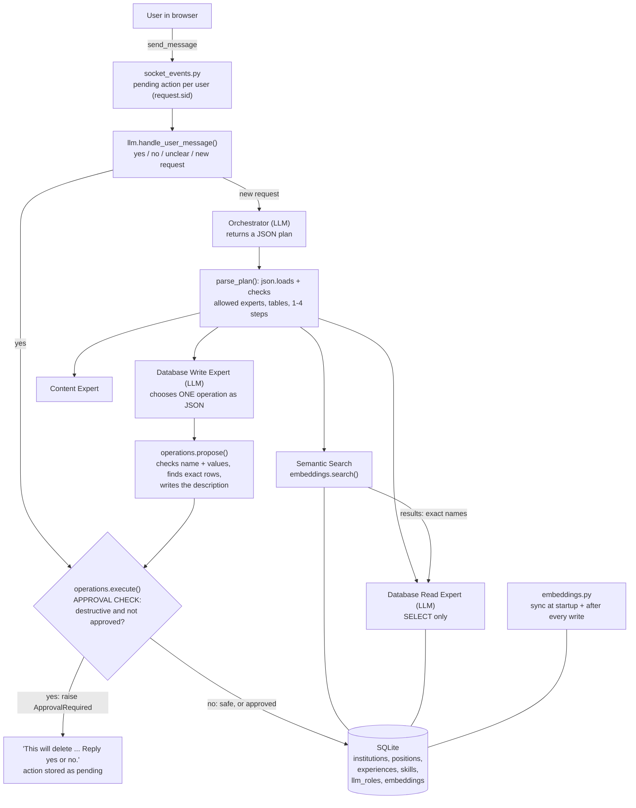

# Design and Testing Report — Homework 2

**Name:** Sama Almasri
**GitHub fork/branch URL:** https://github.com/shahdbatrawi/ai-agents/tree/sama-hw1
**Demo video link:** https://drive.google.com/file/d/1Fs2DvfcNHg4ao-2O7Ywqf4i8JbK28Boo/view?usp=sharing
**Command that runs my tests:** `cd "homework 2"` then `python tests/run_scenarios.py` (add `--verbose` to print every trace)

## 0. Starting point

I ran the four "Before You Start" checks on my HW1:

- **HW1 works?** Partly. Read questions worked ("List all my skills"). Adding a skill *looked* like it worked: "Add Rust to BRAINWORKS" replied *"New Rust added to the skills table."*, but Rust did not appear in the list. When I queried the database directly I found the row `(5, None, 'Rust', 5)`. The Write Expert's generated code could not find BRAINWORKS' `experience_id`, wrote `NULL`, and `exec()` silently turned it into `None` (`{"NULL": None}`). The list query joins skills with experiences, so the row was dropped, but the reply still claimed success. The model had also made up `skill_level = 5`.
- **Restart test:** failed as expected. Rust disappeared after a restart because `createTables(purge=True)` wiped and reloaded everything.
- **`eval()` / `exec()`:** both in `flask_app/utils/llm.py`. `eval(plan_text)` ran the Orchestrator's plan, and `exec(generated_code, {"db": db, "NULL": None})` ran the Write Expert's code.
- **Embedding test:** one call through OpenRouter returned a non-zero vector. All vectors from the same model have the same length, which is why I store the model name with every embedding.
- **Test data:** `homework 2/fixtures/` was not in the repository when I started. Until the official one is published, I built it from the original sample resume (`origin/main:homework 0/.../initial_data/`: Michigan State University, BRAINWORKS, CSE 847, ...) plus three skills: Machine Learning, Neural Networks and Public Speaking.

## 1. How my system works



- **Startup (`__init__.py`, `database.createTables`)**: resume tables are loaded from CSV **only when the database is new**. `llm_roles` is reloaded on **every** start. Then `sync_embeddings()` embeds new or edited records, removes the embeddings of deleted records, and re-embeds everything if the model changes. *HW1:* everything was wiped and reloaded on every start.
- **Embeddings (`embeddings.py`)**: vectors are stored as JSON in the `embeddings` table, together with the exact text that was embedded and the model name. An empty, all-zero or wrong-length vector raises `EmbeddingError` and is never stored or used. *HW1:* none.
- **Search by meaning (`embeddings.search`)**: embeds the question, computes cosine similarity in plain Python, and returns ranked `{table, record_id, text, score}` results. It can be limited to certain tables, and results below `MIN_SIMILARITY` count as "not found". *HW1:* exact SQL match only.
- **Orchestrator (`llm.py`)**: returns a JSON plan with `route`, `reason` and `steps`. `parse_plan()` reads it with `json.loads` and rejects unknown experts or tables. Each step receives the results of the steps before it, and a search that finds nothing stops the plan with "not found". *HW1:* a Python string run with `eval()`.
- **Write Expert + allowed operations (`operations.py`)**: the model only picks one of `add_skill`, `update_skill_level`, `delete_skill` or `delete_all_skills` and fills in its values. `propose()` checks the values against the real data and builds the exact description. `execute()` is the **only** function that writes, and the approval check is inside it. *HW1:* free Python code run with `exec()`.
- **Approval (`llm.handle_user_message`, `socket_events.py`)**: one pending action per user. `yes` runs exactly the stored action without asking the model again. Anything else cancels it. *HW1:* none.
- **Trace**: every message prints `[trace <id>]` lines with the route and reason, the search scores (marked MATCH or below cut-off), each step and operation, the approval state (none / WAITING / APPROVED / CANCELLED) and the outcome.

## 2. Where to find things in my code

| What | File / function / table |
| --- | --- |
| Search by meaning (returns table, ID, text, score) | `flask_app/utils/embeddings.py`: `search()`, `cosine_similarity()`. Storage: table `embeddings` (`create_tables/embeddings.sql`). Sync: `sync_embeddings()`, `embed_record()`, `delete_embedding()` |
| Trace output | `flask_app/utils/llm.py`: `trace()`, called in `handle_user_message()`, `run_orchestrator_plan()`, `run_semantic_search()`, `execute_write_action()` |
| Test command | `tests/run_scenarios.py` (`python tests/run_scenarios.py [--verbose]`) |
| Settings (`.env.example`) | `homework 2/.env.example`: `OPENROUTER_API_KEY`, `EMBEDDING_MODEL`, `MIN_SIMILARITY`, `CHAT_MODEL` |
| Approval check and allowed operations (HW2) | `flask_app/utils/operations.py`: `OPERATIONS`, `propose()`, `execute()` (approval check), `ApprovalRequired`. Pending action and yes/no matching: `llm.handle_user_message()`, stored per user in `socket_events.SESSIONS` |
| Orchestrator plan checking | `flask_app/utils/llm.py`: `parse_plan()`, `ALLOWED_EXPERTS`, `SEARCHABLE_TABLES` |
| Startup / keeping data | `flask_app/utils/database.py`: `createTables()`, `RESUME_TABLES`. `flask_app/__init__.py` |
| Prompts | `flask_app/database/initial_data/llm_roles.csv` |

## 3. Three decisions I made

| Decision | Options I considered | What I chose | Why, and the trade-off | What would make me choose differently |
| --- | --- | --- | --- | --- |
| 1. What loads at startup | (a) keep `purge=True`; (b) just `purge=False`; (c) resume data loaded **once** when the database is new, prompts reloaded **every** start | (c) | (b) is not enough: the old seed ran `INSERT OR IGNORE` on every start, so a deleted CSV skill came back (its ID was free again) and an edited prompt was ignored (its ID already existed). With (c), chat edits survive restarts and prompt edits take effect. **Trade-off:** editing a resume CSV no longer changes the app until I reset the database, which I documented in the README. | If the resume were only ever edited in the CSV files and never through the chat, reloading on every start would be simpler. |
| 2. The "no match" cut-off | a low cut-off (~0.25, always returns something); a high one (~0.6); a value chosen from real scores | `MIN_SIMILARITY = 0.50`, set in `.env` | Real scores from `try_search.py --test`: MSU → Michigan State University **0.623**; "AI skills" → Machine Learning **0.623**, Neural Networks **0.594**, but Javascript 0.473 and Public Speaking 0.424. Harvard's best score was **0.302**, and on my own resume wrong matches reached 0.362. 0.50 sits between the lowest correct match and the highest wrong one. **Trade-off:** a real but weakly worded match under 0.50 is reported as "not found". I prefer a false "not found" to an invented record. | A different embedding model (scores move), or many more records where correct matches score lower. I would then pick per-table cut-offs from a larger labelled set. |
| 3. Which tables a search covers | always search all tables; let the Orchestrator choose tables per question | The Orchestrator picks tables (`skills` for skill questions, `institutions` for places). Leaving `tables` out searches all tables | With all tables, "AI skills" mixed the experience *CSE 491 ... AI Agents* (0.472) in with the skills, and on my own resume the position *Intern at NAID* (0.482) ranked **above every skill**: the S2 trap. Limiting the search to `skills` fixes it. **Trade-off:** if the model picks the wrong table, the right record can't be found, so the fallback is all tables. | If questions were often mixed ("anything about AI"), I would search all tables and group the results by table instead. |
| 4. How `yes` is matched, and the "unclear" rule | ask again on "maybe"; keep the action until a clear answer; cancel on anything except yes/no | Store **one** `Action` object per user. `yes` runs exactly that object. `no`, an unclear word, or a new request **cancels** it | Running the stored object means `yes` can't produce a different action than the one shown, and the model is never asked again. Cancelling on anything else means a late `yes` can never approve an old action (S8). **Trade-off:** a user who types "maybe" has to send the request again. | If users complained about retyping, I would ask again once on "maybe", but still cancel on a change of subject. |
| 5. Separate search step vs. extending the Read Expert | add similarity search to the Read Expert's SQL prompt; make a separate "Semantic Search" step | A separate step with **no LLM** in it, whose results are passed to the next step | Search becomes plain code with visible scores and an exact "not found". The Read Expert only has to copy an exact name into SQL (S4). **Trade-off:** two-step questions need the Orchestrator to plan both steps correctly. | With the ReAct bonus, the agent could decide on the second step after seeing the search results instead of planning it up front. |

## 4. Testing

All scenarios run on the test data with `python tests/run_scenarios.py`. Each scenario starts from a fresh copy of `fixtures/`. Result: **11/11 PASS** (full trace in `evidence_tests.txt`). Earlier runs are saved in `evidence_step4.txt` (routing) and `evidence_step5.txt` (approval).

| Scenario / what I typed | What should happen | What actually happened | Pass / fail | Evidence |
| --- | --- | --- | --- | --- |
| **S1** "Find my MSU experience" | Michigan State University in the top results, with its score in the trace | `route = semantic`, tables `[institutions]`. Michigan State University **0.648 (MATCH)**, next result 0.215 | PASS | `evidence_step4.txt`, `evidence_tests.txt` (S1) |
| **S2** "What AI skills do I have?" | ML-type skills come back; Public Speaking doesn't, or ranks lower | Searched `skills` only. Machine Learning **0.623**, Neural Networks **0.594** (MATCH); Javascript 0.473, Public Speaking below cut-off and not in the reply | PASS | `evidence_step4.txt`, `evidence_tests.txt` (S2) |
| **S3** "List all my skills" | Database Read Expert, not search; the trace says why | `route = sql`, reason *"list everything, no fuzzy words"*. SQL `SELECT name, skill_level FROM skills;` returned all 7 skills | PASS | `evidence_step4.txt` |
| **S4** "What did I do at MSU?" | Two steps: resolve the name, then look it up | Step 1: search MSU → Michigan State University 0.648. Step 2: the Read Expert's SQL used `WHERE i.name = 'Michigan State University'` and returned CSE 477, CSE 847, CSE 491 and Feature Imitating Networks | PASS | `evidence_step4.txt` (trace 3dd064) |
| **S5** Add a skill, restart | Skill and embedding still there; a search by meaning finds it | Test adds *Kubernetes* to BRAINWORKS, rebuilds the database object with normal startup (no purge), checks the row and its embedding, then searches "container orchestration" → top result `Skill: Kubernetes` | PASS | `evidence_tests.txt` (S5) |
| **S6** "Remove Python from CSE 847", then `no` | Exact action shown; database unchanged | *"This will delete skill 'Python' from experience 'CSE 847'. Reply yes or no."* → `no` → *"Cancelled. Nothing was changed."* The 7 skills before = the 7 skills after | PASS | `evidence_step5.txt` |
| **S7** Same request, then `yes` | Only the shown action runs | `approval: APPROVED -> running exactly delete_skill(Python, CSE 847)`. Only Python was removed (7 → 6) | PASS | `evidence_step5.txt` |
| **S8** Deletion → `maybe` → `yes`; deletion → change of subject → `yes` | Nothing runs, nothing approved | `maybe` → *CANCELLED (unclear answer)*, then `yes` → *"There is nothing waiting for your approval"*. A new question → *CANCELLED (user moved on)*, answered normally ("You have 6 skills"), and the later `yes` did nothing | PASS | `evidence_step5.txt` |
| **S9** "Clean up my skills so the list is empty" | Paused, even with no danger word | The Write Expert chose `delete_all_skills()` → `destructive=True` → *"This will delete ALL 6 skills: ... Reply yes or no."*. Nothing deleted | PASS | `evidence_step5.txt` |
| **S10** Embedding call fails (wrong model name, set only inside the test) | Clear error; no fake vectors; app still works | Reply *"Search by meaning is not available right now (embedding API error ...). I did not guess an answer."* 0 vectors stored for the bad model. With the real model restored, the same question matched Michigan State University | PASS | `evidence_tests.txt` (S10) |
| **S11** "Find my Harvard experience" | "Not found"; no invented record | Best score 0.273 < 0.50 → *"nothing found -> stop"* → reply: NOT FOUND | PASS | `evidence_step4.txt` (trace 57ec51) |

**Surprises and failures I found:**

- **A real failure while building Step 5.** The first run of `try_approval.py` crashed on "Add Rust to BRAINWORKS" with `sqlite3.IntegrityError: NOT NULL constraint failed: skills.skill_level`. The user gave no level, and `skills.skill_level` can't be empty. In HW1 the model had silently made up a level. **Fix:** if no level is given, use `DEFAULT_SKILL_LEVEL = 5` and say so in the reply (*"level 5 (default; ask me to change it)"*). I also made `execute()` catch any database error and report *"Nothing was changed"* instead of crashing. After the fix, Rust was saved as `experience_id 4` (BRAINWORKS, not `None`) and its embedding was stored at once.
- **The HW1 bug (`None` experience)** was only visible by looking at the database. The chat reply said the add had worked. That is why my tests check the database, not the reply.
- **The S2 trap was real.** It is shown in decision 3.
- **The first scores I looked at were on my own resume**, which has no MSU at all (best "MSU" score 0.322). I noticed only because the top result was "Guidance". After that I always ran tests on `fixtures/` with a separate database.
- **Windows encoding.** `run_scenarios.py --verbose | Out-File` crashed with `UnicodeEncodeError` (cp1256 could not print the ⚠️ in a reply). Fixed with `sys.stdout.reconfigure(encoding="utf-8")`.
- The HW1 Read Expert's few-shot example used `WHERE i.name = 'MSU'`, so it taught the exact-match bug. I replaced it with the full stored name.

## 5. Limitations

1. **Limitation:** the pending action is kept in memory (`socket_events.SESSIONS`), per connection. **Impact:** if the app restarts or the page reloads, a waiting deletion is lost (it fails safe: nothing runs, but the user has to ask again). It also would not work with several server processes. **How I'd improve it:** store pending actions in a SQLite table with the user ID, the action, its ID and an expiry time, and require the `yes` to arrive before it expires.
2. **Limitation:** one fixed cut-off (0.50) for every table, chosen from about 20 records and one model. **Impact:** with more data or another embedding model, real matches could fall below 0.50 ("not found") or wrong ones rise above it. Short skill names and long experience descriptions score differently. **How I'd improve it:** build a small labelled set of should-match / should-not-match questions per table and choose a cut-off per table. Also show the "closest but below cut-off" result as a suggestion ("Did you mean ...?").
3. _(extra)_ Only skills can be changed. Editing institutions, positions or experiences is not in the allowed operations, so the Write Expert answers "That isn't a change I'm allowed to make". Search is a plain loop over all vectors, which is fine for a resume but would need a vector index for large data.

## 6. My work and the help I used

- **Help I used:** I used an AI assistant (Claude) to explain the assignment, plan the steps, and draft code for `embeddings.py`, `operations.py`, the changes to `database.py`, `llm.py` and `socket_events.py`, the new prompts in `llm_roles.csv`, the helper scripts and `tests/run_scenarios.py`. I also used the OpenRouter embeddings documentation, and Python's `sqlite3`, `json`, `math` and `requests`.
- **What I did myself:** I ran the HW1 checks and found the `(5, None, 'Rust', 5)` bug by querying the database. I set up the test data when `fixtures/` was missing. I ran every step and read the real scores, then chose the cut-off and the table decision from them. I found and reported the failures (port 8080 in use, the NOT NULL crash, the Windows encoding error) and tested the fixes. I also tested the app in the browser on my own resume ("Remove Java from CSE847" → paused → `no` → nothing changed).
- **What I checked after getting help:** each change was tested before moving on (startup output, embedding counts, `try_search.py --test`, `try_orchestrator.py --test`, `try_approval.py`, then `tests/run_scenarios.py`). I can explain where the approval check is and why no wording can skip it.

## 7. How to run it

```powershell
# from the repository root
.\venv\Scripts\Activate.ps1
pip install -r requirements.txt
# create .env in the repository root with:
#   OPENROUTER_API_KEY, EMBEDDING_MODEL, MIN_SIMILARITY (0.50), CHAT_MODEL (optional)
cd "homework 2"
python app.py                       # app on http://localhost:8080 (my own resume)
python tests/run_scenarios.py       # S1-S11 on the test data, PASS/FAIL per scenario
```

**Reset the test data only:** the tests load `fixtures/` into a separate file (`tests/test_resume.db`), start every scenario from a fresh copy, and delete the file at the end, so every test run starts clean. To reset by hand: `Remove-Item tests\*.db, test_resume.db -ErrorAction SilentlyContinue`. My real resume (`flask_app/database/resume.db`) is never touched by the tests.
